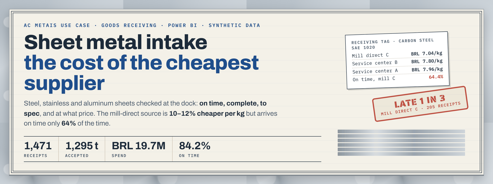
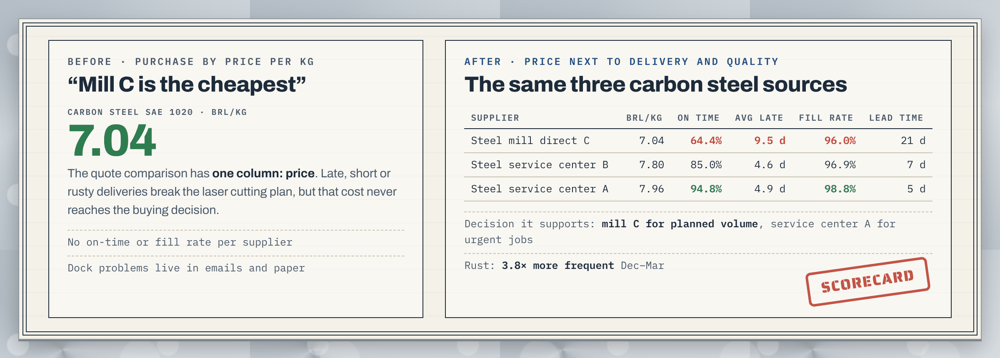
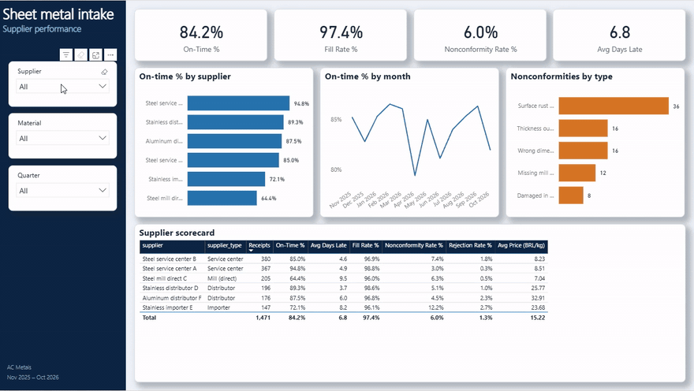
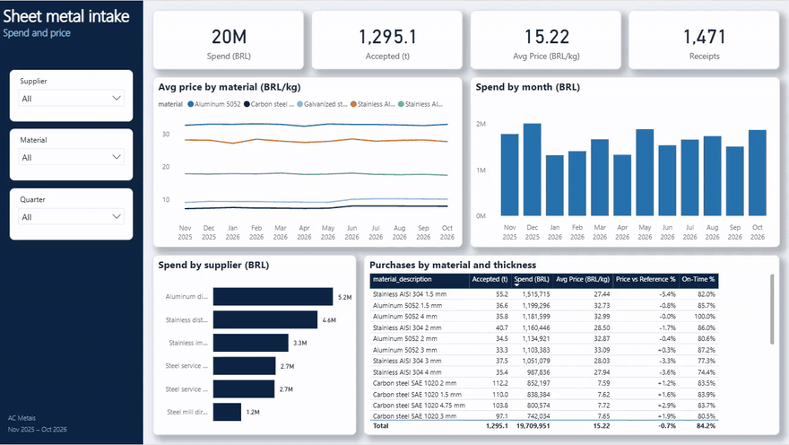
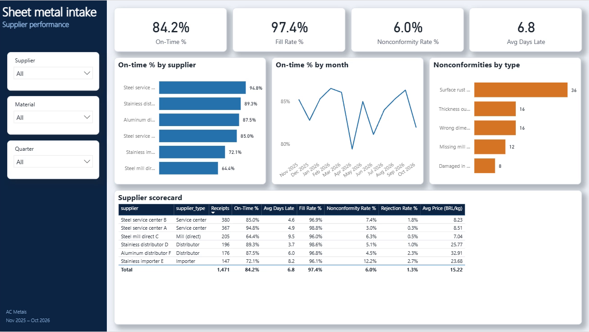
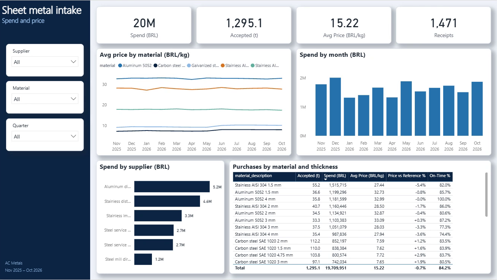

# Sheet Metal Intake · Supplier Performance



A Power BI dashboard for receiving steel, stainless and aluminum sheets in a metal fabrication shop. It puts price next to delivery and quality for each supplier.

| | |
|---|---|
| **Problem** | Purchasing chose suppliers by price per kg only. Late, short or rusty deliveries broke the cutting plan, but nobody tracked them in one place. |
| **Solution** | A dashboard that shows each supplier's on-time rate, delivered quantity and quality problems next to its price. |
| **Result** | The cheapest supplier is 10–12% cheaper but on time only 64% of the time, against 95% for the best one. Purchasing can now choose by price and reliability. |
| **Tools** | Power BI · DAX · Power Query · Excel |
| **Context** | I worked with BI at AC Metais, a Brazilian laser cutting and metal fabrication company. This dashboard rebuilds a receiving case from that shop with synthetic data. |

---

## The problem



Sheet metal is the main raw material of a laser cutting shop. Purchasing compared quotes by price per kg. Nobody checked, in one place, whether sheets arrived on the promised date, in the ordered quantity and without defects. A late or rusty delivery stopped the cutting plan, but that cost never reached the buying decision.

## The dashboard

Two pages, published in the Power BI Service. Filters and cross-filtering work on both.

**Supplier performance.** Are suppliers delivering on time, complete and without defects? On-time rate by supplier and by month, quality problems by type, and a scorecard with all suppliers side by side.



**Spend and price.** How much are we buying, from whom, and at what price? Price by material over time, spend by month and by supplier, and a table by material and thickness.



<details>
<summary><b>Full-size screenshots</b></summary>





</details>

## Results

Synthetic data, November 2025 to October 2026:

| | |
|---|---|
| Receipts | 1,471 from 6 suppliers |
| Accepted | 1,295 t · BRL 19.7M |
| On time | 84.2% |
| Quantity delivered vs ordered | 97.4% |
| Lots with a quality problem | 6.0% (19 lots rejected) |

| Carbon steel SAE 1020 | BRL/kg | On time | Avg days late |
|---|---:|---:|---:|
| Steel mill direct C | 7.04 | 64.4% | 9.5 |
| Steel service center B | 7.80 | 85.0% | 4.6 |
| Steel service center A | 7.96 | 94.8% | 4.9 |

**Decision it supports:** keep the cheap mill for planned, non-urgent volume, use the reliable service center for urgent jobs, and ask for better packaging in the rainy season, when rust problems are 3.8× more frequent.

## Files

```
data/sheet_metal_intake.xlsx    synthetic data
powerbi/SheetMetalIntake.pbip   the Power BI report
docs/                           images
```

To open it in Power BI Desktop:

1. Open `powerbi/SheetMetalIntake.pbip`.
2. *Transform data → Edit parameters →* set **DataFolder** to the full path of the `data` folder, ending with `\`.
3. *Refresh.*

## How this was built

The problem and the business rules come from my BI work at AC Metais. The data is synthetic; nothing comes from the company. I used an AI assistant to help build the report faster and reviewed the result.

---

Lucas Fernandes Nunes · [Portfolio](https://lucasnunesf.notion.site/Lucas-Nunes-Data-BI-Analyst-3de917c89c178092885cf639b619767b) · [GitHub](https://github.com/lucasnunesf)
