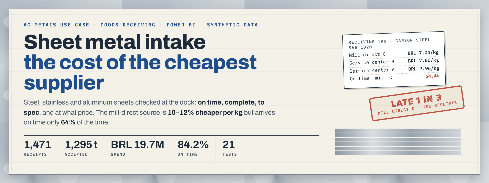
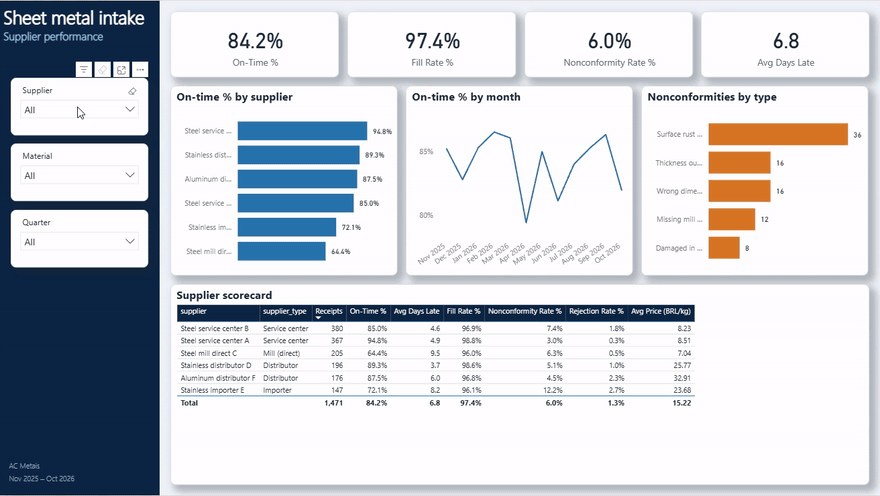
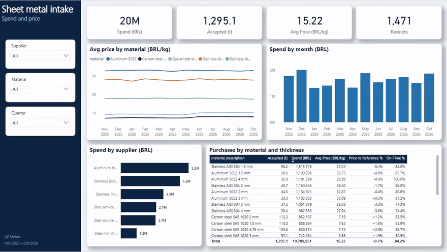
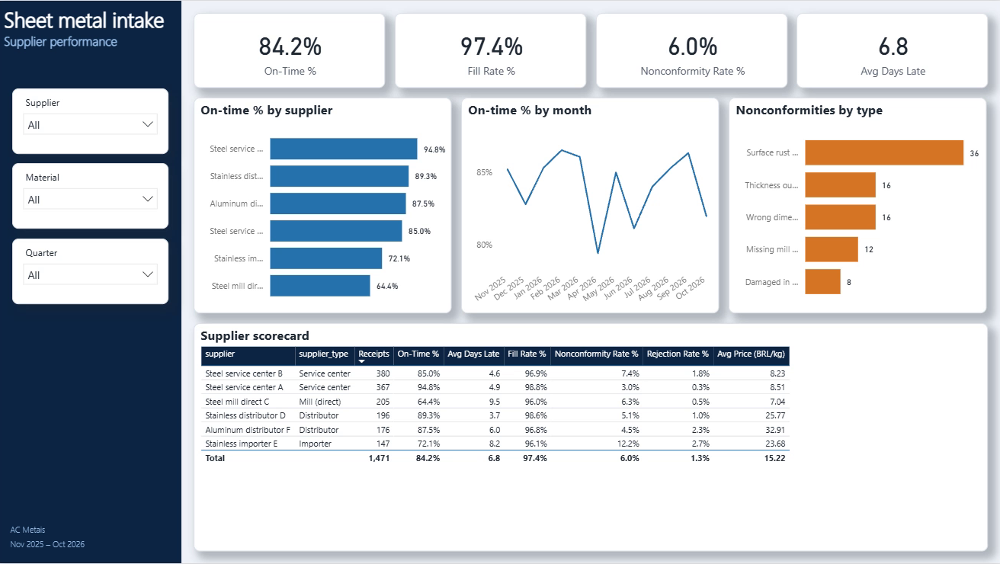
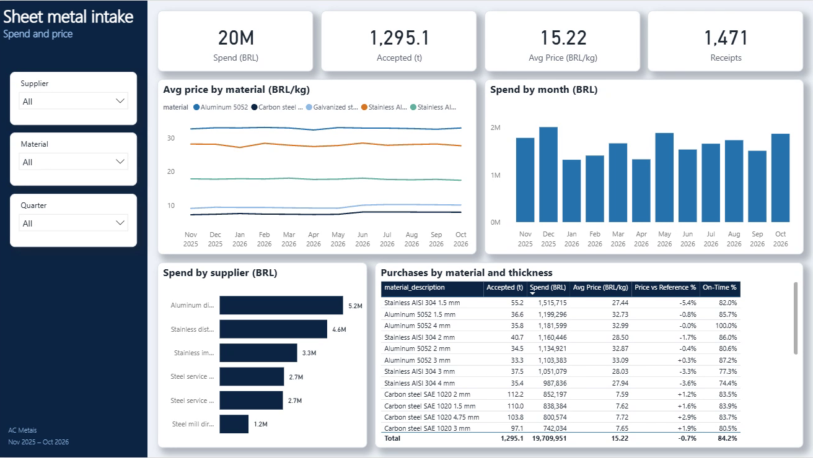
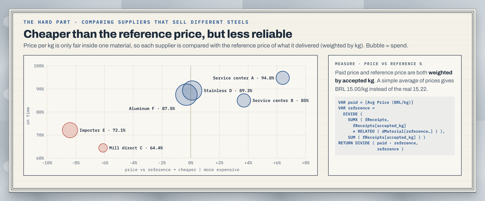
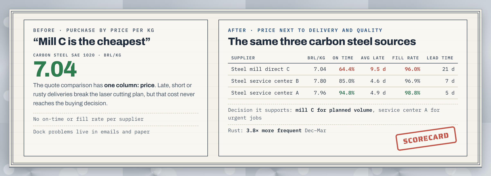
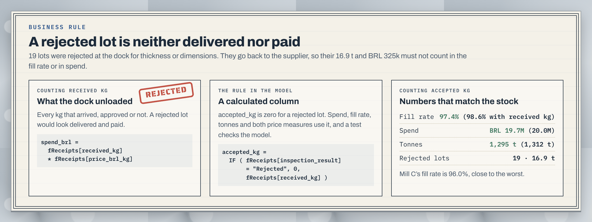
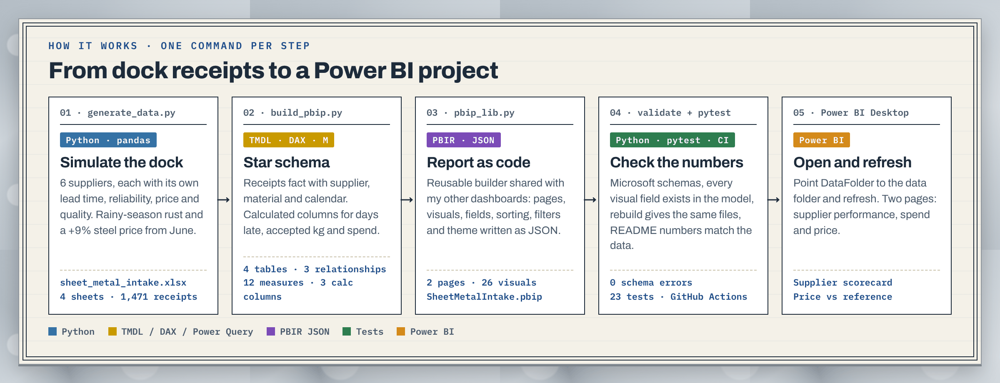

# Sheet Metal Intake · Supplier Performance

A Power BI dashboard for goods receiving of steel, stainless and aluminum sheets in a metal fabrication shop. It puts price next to delivery and quality, and shows that the cheapest supplier is also the least reliable.




[](https://github.com/lucasnunesf/sheet-metal-intake-dashboard/actions/workflows/tests.yml)

| At a glance | |
|---|---|
| **Result** | The mill-direct source is 10–12% cheaper per kg of carbon steel but on time only 64% of the time, against 95% for the best service center. Rust problems are 3.8× more frequent in the rainy months. |
| **My role** | I worked with BI at AC Metais, a Brazilian laser cutting and metal fabrication company. This repository rebuilds a receiving use case from that shop with synthetic data: data generator, data model, DAX, report pages, tests. |
| **What's here** | A Power BI project (`.pbip`) written by Python and published to the Power BI Service: 4 tables, 12 DAX measures, 2 pages, 26 visuals. A data generator, a pandas check of the numbers, 23 automated tests, CI on every commit. |
| **Skills** | Power BI, DAX, Power Query (M), star schema, weighted averages, supplier scorecards, TMDL / PBIR, Python (pandas), pytest, GitHub Actions |
| **Full case** | [docs/case-study.md](docs/case-study.md) |

All data is synthetic. Nothing here comes from the company.

---

## The dashboard

Recorded in the Power BI Service after publishing the project. Slicers and cross-filtering work on both pages.

**Supplier performance.** Are suppliers delivering on time, complete and to spec? Clicking a supplier shows its own on-time, fill rate and nonconformity rate, and the scorecard puts them side by side.



**Spend and price.** How much are we buying, from whom, and at what price? Price by material over time, spend by month and supplier, and price vs reference by material and thickness.



<details>
<summary><b>Full-size screenshots</b></summary>





</details>

---

## Results

Numbers from the dataset, November 2025 to October 2026:

| | |
|---|---|
| Receipts | 1,471 from 6 suppliers |
| Accepted | 1,295 t · BRL 19.7M |
| On time | 84.2% |
| Fill rate (accepted kg ÷ ordered kg) | 97.4% |
| Nonconformity rate | 6.0% (19 lots rejected) |
| Carbon steel price | +8.9% from June 2026 |



| Carbon steel SAE 1020 | BRL/kg | On time | Avg days late | Fill rate | Promised lead time |
|---|---:|---:|---:|---:|---:|
| Steel mill direct C | 7.04 | 64.4% | 9.5 | 96.0% | 21 days |
| Steel service center B | 7.80 | 85.0% | 4.6 | 96.9% | 7 days |
| Steel service center A | 7.96 | 94.8% | 4.9 | 98.8% | 5 days |

Decision it supports: keep the cheap mill for planned, non-urgent volume, use the reliable service center for urgent jobs, and ask for better packaging and storage in the rainy season.

---

## The problem



Sheet metal is the main raw material of a laser cutting shop. Purchasing compared quotes by price per kg. Nobody tracked, in one place, whether sheets arrived on the promised date, in the ordered quantity and within spec. A late or rusty delivery broke the cutting plan, but that cost never reached the buying decision.

The dashboard answers two questions, one per page:

- **Supplier performance.** Are suppliers delivering on time, complete and to spec? KPI cards (on time, fill rate, nonconformity rate, average days late), on time by supplier and by month, nonconformities by type and a supplier scorecard.
- **Spend and price.** How much are we buying, from whom, and at what price? KPI cards (spend, tonnes, average BRL/kg, receipts), price trend by material, monthly spend, spend by supplier and a table by material and thickness with the price vs reference.

---

## Two rules the numbers depend on

### A rejected lot is neither delivered nor paid



A lot rejected at the dock goes back to the supplier: it never enters the stock and is not paid. So the model counts accepted kg, not received kg. A calculated column, `accepted_kg`, is zero for a rejected lot, and spend, fill rate, tonnes, average price and price vs reference all use it.

In this dataset that rule takes out 19 lots, 16.9 t and BRL 325k. Counting received kg instead would show a fill rate of 98.6% instead of 97.4%. `tests/test_kpis.py` checks both the data and the model, so a measure can't go back to received kg.

### A filter inside a measure must not replace the user's click

Recording the published report showed a problem with this. Clicking "Surface rust" in the nonconformities chart made the nonconformity rate card jump to 244.4%. The measure counted nonconformities with `CALCULATE ( ..., fReceipts[nonconformity] <> "No issue" )`, and that filter replaced the click on the same column: it counted all 88 nonconformities and divided by the 36 rusty receipts.

Wrapping the filter in `KEEPFILTERS` makes it intersect with the click instead of replacing it, so the rate inside one type is 100%. The same fix went into on-time, late receipts, average days late and rejection rate, and a test now fails if a measure filters a receipts column without `KEEPFILTERS`.

---

## How it works



| Step | What it does | Language | Output |
|---|---|---|---|
| `scripts/generate_data.py` | Creates receipts from 6 suppliers, each with its own lead time, reliability, price and quality. Seeded, so it always gives the same data. | Python | `data/sheet_metal_intake.xlsx` |
| `scripts/build_pbip.py` | Describes the dashboard: tables, Power Query, relationships, DAX measures, pages and visuals. | Python | `powerbi/SheetMetalIntake.pbip` |
| `scripts/pbip_lib.py` | Small reusable builder that writes the model in TMDL and the report in PBIR (one JSON file per page and visual). | Python | TMDL + PBIR files |
| `scripts/validate_pbir.py` | Checks every report file against Microsoft's JSON schemas. | Python | `0 schema errors` |
| `scripts/kpi_snapshot.py` | Computes the main numbers with pandas, using the same logic as the DAX, so they can be checked without Power BI. | Python | numbers in the terminal |

### Data model

Star schema, filters in one direction, imported from one Excel file.

```
 dSupplier 1 ──── * fReceipts * ──── 1 dMaterial
                       │ *
                       │ 1
                   dCalendar (received_date)
```

| Table | Grain | Rows |
|---|---|---|
| `fReceipts` | one receipt (purchase order line delivered) | 1,471 |
| `dSupplier` | supplier | 6 |
| `dMaterial` | material + thickness | 26 |
| `dCalendar` | day | 365 |

## Design decisions

- **Average price weighted by kg.** A simple average of prices treats a 50 kg delivery like a 5 t one. Over the year it gives BRL 15.00/kg instead of the real 15.22.
- **Compare each supplier with a reference price.** Stainless costs four times more than carbon steel, so BRL/kg across suppliers means nothing. Each supplier is compared with the reference price of what it delivered:

```DAX
Price vs Reference % =
VAR paid = [Avg Price (BRL/kg)]
VAR reference =
    DIVIDE (
        SUMX ( fReceipts, fReceipts[accepted_kg] * RELATED ( dMaterial[reference_price_brl_kg] ) ),
        SUM ( fReceipts[accepted_kg] )
    )
RETURN DIVIDE ( paid - reference, reference )
```

- **Delivery, quality and price in one table.** The scorecard puts on time, days late, fill rate, nonconformity, rejection and price side by side, because the decision needs all of them at once.
- **Report as code.** The `.pbip` format is plain text, so the model and every visual can be reviewed in a pull request and rebuilt with one command.

---

## Try it

```bash
pip install -r requirements.txt
python scripts/generate_data.py
python scripts/build_pbip.py
python scripts/kpi_snapshot.py
```

Output:

```
1,471 receipts written to .../data/sheet_metal_intake.xlsx
Built .../powerbi/SheetMetalIntake.pbip: 4 tables, 12 measures, 2 pages, 26 visuals

Receipts                   1,471
Accepted                   1,295 t   spend BRL 19.7M
On time                    84.2%
Fill rate (accepted kg)    97.4%   rejected lots: 19
Nonconformity rate         6.0%
Rust, rainy vs dry months  3.8x
Carbon steel price change  +8.9% from June 2026

Carbon steel, BRL/kg by supplier
supplier
Steel mill direct C       7.04
Steel service center A    7.96
Steel service center B    7.80
```

Then, on Windows:

1. Open `powerbi/SheetMetalIntake.pbip` in Power BI Desktop.
2. *Transform data → Edit parameters →* set **DataFolder** to the full path of the `data` folder, ending with `\`.
3. *Refresh.*

## Tests

```bash
git clone --depth 1 https://github.com/microsoft/json-schemas.git   # optional, for the schema test
pytest
```

```
============================== 23 passed in 2.81s ==============================
```

| File | What it checks |
|---|---|
| `tests/test_data.py` | The generator gives the same file every time. Keys match. Each supplier only sells its own materials. Received never exceeds ordered. Weight matches sheet size, thickness and density. Only measurable defects lead to a rejected lot. |
| `tests/test_model.py` | Rebuilding gives exactly the files in the repository. Every column and measure used by a visual or a DAX formula exists in the model (the JSON schemas don't check this). A broken visual is caught. All report files pass Microsoft's schemas. |
| `tests/test_kpis.py` | Every number in this README is recomputed from the data. Rejected lots count as zero accepted kg and zero spend, in the data and in the model. Measure filters keep the visual's filter (`KEEPFILTERS`). |

GitHub Actions runs the tests on every commit.

<details>
<summary><b>Project layout</b></summary>

```
data/sheet_metal_intake.xlsx      synthetic data (4 sheets)
scripts/generate_data.py          data generator (seeded)
scripts/pbip_lib.py               reusable TMDL + PBIR builder
scripts/build_pbip.py             dashboard definition
scripts/validate_pbir.py          schema validation
scripts/kpi_snapshot.py           main numbers with pandas
powerbi/SheetMetalIntake.pbip     open this in Power BI Desktop
tests/                            data, model and number tests
docs/                             case study and README images
```

</details>

<details>
<summary><b>Glossary</b></summary>

- **Service center**: a distributor that cuts and stocks steel close to the customer. Faster, a bit more expensive than the mill.
- **On time**: received on or before the promised date.
- **Fill rate**: accepted kg ÷ ordered kg.
- **Nonconformity**: a problem found at the dock (rust, thickness out of tolerance, wrong dimensions, transport damage, missing mill certificate).
- **Mill certificate**: the document from the steel mill with the chemical and mechanical properties of the batch.
- **SAE 1020 / AISI 304 / 5052**: common grades of carbon steel, stainless steel and aluminum.

</details>

---

## Next steps

- Read receipts from the ERP and the inspection checklist instead of the generator.
- Add the cost of a late delivery (hours of laser idle or overtime) to the scorecard, so the cheapest supplier can be compared on total cost.
- Alert purchasing when a supplier's on-time rate drops below a target for two months in a row.

## How this was built

The problem, the business rules and the design decisions are mine. They come from my BI work at AC Metais. I used an AI coding assistant to write the code faster and reviewed the result.

<!-- Lucas: write here, in your own words, one or two sentences about where you saw this problem happen. -->

## Author

Lucas Fernandes Nunes · [Portfolio](https://lucasnunesf.notion.site) · [GitHub](https://github.com/lucasnunesf)
